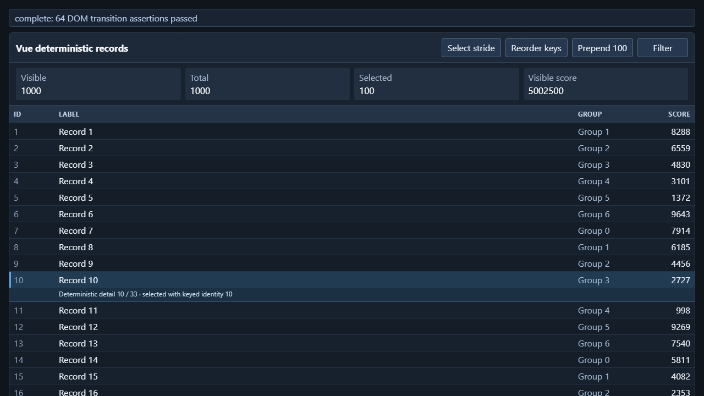
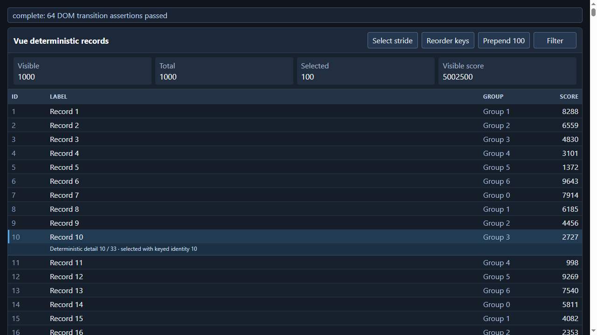

# 2026-10-22：mini-ui 与真实 Google Chrome 的 Vue / React 对照

## 结论

- 修正字体初始化后，mini-ui 8 个矩阵单元、Chrome 默认 GPU 8 个、Chrome 软件模式 8 个均完成，**24/24 正常退出 0**。每单元 64 项 DOM 状态断言，共 1,536 项；没有用跳过断言、减少 DOM、空回调或假渲染取得成功。
- 同机相同生产包、相同真实 DOM 工作量下，mini-ui 的每轮七项 JS/DOM commit 总耗时中位数为 Chrome 默认路径的 **30.71–56.77 倍**；不是同等性能。Chrome 禁用 GPU 后差距仍在，不能把主指标差距归因于 GPU。
- 大表格内存是优先问题：10,000 行 Vue 在 populated capture 时为 **7.84 GiB private commit**，React 为 **2.92 GiB**。这不是工作集、峰值 RSS 或最终存活对象大小。
- 已修复真实压测发现的联合 GC 重扫缺陷，以及默认字号、系统字体、Windows 字体参数的真实初始化缺陷。剩余优化候选和证据边界见下文；不编造可实现的倍数。
- 用户已取消关机：没有执行关机命令。

## 环境与方法

| 项目 | 实际值 |
|---|---|
| OS / CPU / 内存 | Windows 10 build 19045 x64；Intel Core i9-13900K，32 logical processors；32 GiB RAM |
| 电源计划 | 卓越性能；未设置 CPU affinity 或固定频率 |
| GPU | NVIDIA GeForce RTX 3090，driver 32.0.15.7216 |
| Chrome | 实际安装的 `C:\Program Files\Google\Chrome\Application\chrome.exe`，**155.0.8059.85**，V8 **15.5.35.25**；headful，不是下载的测试 Chromium、headless 或伪浏览器 |
| Chrome 二进制 SHA-256 | `de999bce6a1c954df71a8f15bf751b336172f55ac1a0325bb0580cbc2121268c`；默认/软件两模式一致 |
| 原生库 SHA-256 | `ac9ecbfad62e72af6e59d1c4071d6509fdf8702f9cdd5847d8bbe2b7c17ca39a` |
| 编译 | clang-cl / lld-link 22，MSVC headers 14.38.33130，Windows SDK 10.0.26100.0；当前官方 compile flags 含 `/O1 /Ob2` |
| 框架 | Vue 3.5.13；React / ReactDOM 18.3.1 实际 production bundles；下载地址、许可证、SHA-256 均保留 |
| 视口 | 两端实际 1280×720 CSS px，device scale / DPR = 1 |
| 矩阵 | Vue、React × 100 / 1,000 / 5,000 / 10,000 行；每 cell 新进程/新私有 profile；2 warmups + 7 measured iterations |
| 七项操作 | mount、update_selected、keyed_reorder、prepend 100、filter、restore、unmount；嵌套 row/detail 组件、derived totals、真实 keyed identity、Vue computed/nextTick、React hooks/memo/flushSync |
| 运行隔离 | 原生矩阵与两个 Chrome 矩阵顺序执行；计时期间没有并发构建、另一组压测或调试器；不声称整台机器没有其他后台任务 |

主要指标来自同一个 `common.js` 的 `performance.now()` 区间：状态变更至 Vue nextTick / React flushSync 的真实 DOM commit，**不包含随后共用的 DOM 断言与 paint**。每轮先对齐七项样本求和，再对七轮计算 median / nearest-rank p95；不是把七项各自 median 相加。

7 个样本的 nearest-rank p95 实际是最大值，不是稳健尾延迟估计。Chrome 实测 timer resolution 约 0.1 ms；零读数是量化，零分母不输出速度比。原始数据保留未四舍五入值。

Native offscreen `View::Tick` 不受显示器 vsync 节奏约束；Chrome rAF 受其调度影响。因此整段 workload wall time、CPU offscreen throughput、启动和关闭时间不能冒充浏览器 onscreen FPS 或引擎加速比。

## 主指标：每轮七项 JS / DOM commit 合计，ms

倍率 = mini-ui median / Chrome 默认 median，**越大表示原生更慢**。软件列是 Chrome `--disable-gpu` 的独立完整矩阵。

| 框架 | 行数 | mini-ui median / p95 | Chrome 默认 median / p95 | Chrome 软件 median | 原生 / 默认 |
|---|---:|---:|---:|---:|---:|
| Vue | 100 | 313.5 / 317.6 | 7.7 / 8.2 | 7.7 | 40.71× |
| Vue | 1,000 | 2,327.6 / 2,341.6 | 41.0 / 48.9 | 41.8 | 56.77× |
| Vue | 5,000 | 11,901.9 / 12,280.4 | 216.6 / 230.2 | 220.8 | 54.95× |
| Vue | 10,000 | 24,178.2 / 24,601.0 | 487.0 / 555.1 | 483.7 | 49.65× |
| React | 100 | 138.2 / 139.0 | 4.5 / 5.4 | 5.1 | 30.71× |
| React | 1,000 | 940.5 / 951.8 | 25.6 / 27.2 | 24.3 | 36.74× |
| React | 5,000 | 6,092.6 / 6,117.3 | 147.2 / 156.5 | 137.1 | 41.39× |
| React | 10,000 | 16,643.0 / 16,930.4 | 380.4 / 411.2 | 418.3 | 43.75× |

## 1,000 行逐项定位，median ms

| 框架 | 操作 | mini-ui | Chrome 默认 | 原生 / 默认 |
|---|---|---:|---:|---:|
| Vue | mount | 556.9 | 8.7 | 64.01× |
| Vue | update_selected | 99.5 | 1.9 | 52.37× |
| Vue | keyed_reorder | 464.6 | 9.3 | 49.96× |
| Vue | prepend | 526.4 | 6.0 | 87.73× |
| Vue | filter | 84.7 | 4.8 | 17.65× |
| Vue | restore | 564.7 | 7.7 | 73.34× |
| Vue | unmount | 27.2 | 3.8 | 7.16× |
| React | mount | 249.4 | 3.9 | 63.95× |
| React | update_selected | 38.6 | 0.7 | 55.14× |
| React | keyed_reorder | 201.0 | 5.5 | 36.55× |
| React | prepend | 123.9 | 2.0 | 61.95× |
| React | filter | 44.9 | 4.3 | 10.44× |
| React | restore | 250.2 | 3.9 | 64.15× |
| React | unmount | 29.1 | 4.1 | 7.10× |

`prepend`、`restore`、mount 和 keyed reorder 仍很昂贵；只针对绘制优化不能直接解释或消除这些不含 paint 的 commit 差距。

## 内存：populated capture 后的 private commit，MiB

mini-ui 是单进程；Chrome 是当前受控 job 内所有活跃进程 private bytes 的和，包含 browser / renderer / GPU 等。两者都是实际应用宿主范围，不是纯 JS engine heap。Chrome summed working set 会重复共享页；本表不用它冒充物理 RSS。原生 100 行时 private footprint 小于 Chrome，但大表格增长很快。

| 框架 | 行数 | mini-ui 单进程 | Chrome 默认整 job | Chrome 软件整 job |
|---|---:|---:|---:|---:|
| Vue | 1,000 | 884.61 | 639.46 | 405.82 |
| Vue | 10,000 | 8,023.65 | 2,051.21 | 2,009.20 |
| React | 1,000 | 355.07 | 572.25 | 358.86 |
| React | 10,000 | 2,986.68 | 2,063.98 | 1,592.34 |

## CPU 与析构：单独口径，不计算引擎加速比

CPU 为真实 kernel+user CPU 秒；原生包含 C++ controller，Chrome 为 job 内 browser 及后代（含已退出进程）的累计，不包含 Python controller；区间均截至 populated capture，排除 teardown。View 析构并非 Chrome 整浏览器关闭的同一行为。

| 框架 | 行数 | mini-ui CPU s | Chrome 默认 job CPU s | 原生 View teardown ms |
|---|---:|---:|---:|---:|
| Vue | 1,000 | 26.469 | 3.766 | 602.6 |
| Vue | 10,000 | 271.875 | 26.672 | 6,903.3 |
| React | 1,000 | 13.859 | 3.891 | 150.5 |
| React | 10,000 | 201.484 | 24.703 | 2,161.0 |

每个 cell 的 cold startup、完整进程 wall、workload wall、offscreen Tick 分布、工作集、生命周期 peak working set、frame generation / stride 和退出结果均保留在 raw JSON / aggregate 中。没有仅因应用写完 JSON 就当作正常退出。

## 正确性与已经实施的修复

1. **联合 GC 复杂度**：`JointVisitor::Drain` 原来在同一 epoch 多次 drain 时从 0 重扫增长前缀；现在游标随 epoch 保持，weak-handle compaction 使用稳定线性压缩，ephemeron fixed point 保留。1,000 行 Vue 的一次实际前后观察为 193.730 s → 30.295 s 完整进程 wall；各一次、且都在字体修复前，**不是最终 Chrome 对照，也不是统计加速承诺**。见 [GC regression](gc-regression.json)。
2. **字体初始化**：bare WebView 的 font prefs 为零，旧原生截图继承正文异常细小，`system-ui` 还暴露未初始化 menu-font family。采用 canonical 16/13/0/6 字号、实际 Win32 96-DPI NONCLIENTMETRICS 与原生字体设置。启用实际字体偏好时进一步发现已选中的 `FontUtilWin::GetTextParameters` 有写地址 1 的 crash sentinel，现恢复真实 Skia defaults / registry / DirectWrite 参数算法，而非假值或吞错。永久 host regression 验证 inherited/system-ui DOM 与 Canvas metrics。见 [font regression](font-regression.json)。
3. 原生正式宿主和 14 个真实 native consumers，共 **15/15 正常退出 0**：本地资源/权限、Blob headers/bytes/active I/O、双堆 GC、clone/transfer、回调 realm、真实 HWND focus/tab/geometry/IME/cursor/PointerLock、隔离 WindowStation Clipboard、CPU text/image roundtrip、CSS animation 等。没有改锁定的 callback / Clipboard / pool 合同。见 [native validation](native-validation.json)。

旧的字体异常 native 矩阵在 [mini-ui-before-font-init](mini-ui-before-font-init/)，其比较单独保存在 `comparison-before-font-init.json`。最终表只使用修正后的库，不混用旧数值。

## 最终库的独立内存诊断：不是 benchmark 样本

同一 pinned workload，1,000 行、2+7 轮；实际调用 JS / weak / native 联合回收，验证挂载 DOM 仍存活，并在 View 销毁后额外执行 main idle drain + collection。未改变生产回收调度，未给最终 matrix 加 forced GC。两个诊断均正常退出 0，库 SHA 与本报告相同。

下表为 workload 已 unmount、尚未 prepareCapture 时的真实快照：

| 框架 | JS used MiB：回收前 → 后 | native used MiB：前 → 后 | OS private MiB：前 → 后 | joint epoch |
|---|---:|---:|---:|---:|
| Vue | 426.90 → 42.16 | 78.53 → 0.58 | 854.18 → 626.45 | 0 → 4 |
| React | 63.17 → 2.70 | 102.77 → 0.60 | 351.68 → 164.93 | 0 → 4 |

这证明有大量可回收对象，但**不能**声称 OS private 同样下降 90%。`js_trigger_gc` 的 allocator trigger 当前被注释，卸载后 epoch 仍为 0。详见 [Vue final heap](native-diagnostics-final/vue-1000-memory.json)、[React final heap](native-diagnostics-final/react-1000-memory.json)。

View 释放并重复回收到 epoch 17 后：Vue wrappers/edges 为 **0/0**；React 仍为 **6,240 / 6,239**，JS used 13.80 MiB、native used 2.81 MiB。该残留值得优先做 root attribution；目前没有证据把它直接命名为内存泄漏，也不能仅用“尚未触发 GC”解释。`MessagePort` / Scheduler callback / detached realm 或 facade root 是 **[INFERENCE] 候选**，不是已证明的根。不能靠清空合法 callbacks 或改 Clipboard/shutdown 来掩盖。

## 优化空间与优先级

| 优先级 | 证据 | 决策与验证目标 |
|---|---|---|
| P1：安全点的预算化联合 GC | 最终诊断 9 轮后 epoch0、JS/native used 可大幅收回；10k Vue private 7.84 GiB | 在 host quiescent/safe point 协调现有 JS/weak/native collectors，而非只打开 QuickJS 单边 allocator GC。A/B 记录 private/live heap、每次暂停 median/p95、吞吐和同一矩阵；必须保留 rooted/mixed-cycle/ephemeron/active-I/O invariants。收益未知，不把 forced-GC 诊断当生产成绩。 |
| P1：DOM bridge atom/dispatch | `FindNative` 对 property vector 线性扫描，每个 key 做 JS_ValueToAtom + FreeAtom；HostGet 还先构造 scope/CallbackState | **[INFERENCE]** 缓存/索引 native property atoms、避免不需要 callback 时的准备工作值得优先 A/B；必须保留 security、receiver、interceptor、symbol、realm、异常及 generation semantics，不能绕过检查。 |
| P1/P2：React view 释放后的 root attribution | mounted graph 的 wrappers 在 View 释放、idle 和多轮 GC 后不降 | 区分 Scheduler pending callback、MessagePort listener、realm finalizer、facade persistent roots；与显式真实 unmount-before-destroy 做独立对照。先定位再修，不恢复 transport 或添加假释放。 |
| P2：handle arenas / allocator high-water | Isolate 保留 cell/view block free lists；Vue wrappers0 后 private 仍约190.57 MiB | 分别量化 live cells、block capacity、allocator free/committed、Skia caches。**[INFERENCE]** 池容量/碎片可能贡献 residual，尚无可归因字节数；只回收没有存活稳定地址/代际引用的块。 |
| P2：局部编译选项 A/B | 当前源码/consumer compile flags 为 `/O1 /Ob2`，偏 size | **[INFERENCE]** 可只对 QuickJS/bridge 热 TU 试 `/O2`，保留同一 workload/hash/矩阵并记录二进制体积；更 aggressive 优化不保证更快，不能未测即改全库或宣称收益。 |
| P3：CPU layout/paint/cache | 实际 CPU frame timings 已记录；早期12个主线程断点快照中9个在 VM/interop/alloc、1个native GC、2个layout/paint | 这些是**字体修复前、低样本有偏 snapshots，不是 CPU百分比**。先做精确采样/分配 attribution，再改CPU invalidation/paint；Chrome软件控制显示主 commit 差距不需要GPU解释，不把恢复GPU作为方案。 |

QuickJS interpreter 与 V8 JIT 的结构差异是 **[INFERENCE]** 的长期成本来源；当前数据没有分离出其百分比，也没有证明上述局部优化足以消除几十倍差距。预编译 JS 主要改善 cold startup，不等于改善 steady-state DOM commit。大表格 virtualize 可以作为**另一个应用级测试**，不能悄悄减少本矩阵 DOM 来美化成绩。

精确 source hashes / 位置：[optimization-source-evidence.json](optimization-source-evidence.json)。Chrome 独立 CPU profiles 在 [chrome-profiles](chrome-profiles/)，早期 native debugger samples 在 [native-diagnostics](native-diagnostics/)；这些 instrumented 数据都不进入主表。

## 清理和交付体积

- 精确 hash-anchored 记录删除 1,176 个 legacy 文件，19,138,061 bytes；另记录 V8 JS engine implementation 目录 58,375,577 bytes，以及 Node/OpenSSL/ANGLE/Dawn/media/storage 等 vendor 代码 613,179,676 bytes。**阶段口径独立，不相加冒充净减少量。**
- 保留实际编译头、IDL/Mojo/schema/JSON5/GN 生成输入、CppGC/native V8 base/libplatform、RE2 与许可证。详见 [cleanup manifest](cleanup-manifest.json) 与 [post-validation cleanup](cleanup-post-validation.json)。
- 验证完成后删除本任务专用 `.build-tools/ui-smoke`（实际 `du -sb` 为 2,585,023,136 bytes）、已记录的 Blob fixtures 和最初失败 Chrome profile；保留正式产品、永久压测源码/结果及其他用户输出。临时 consumers 不加入产品 source selection，其执行命令、源码 hashes 和实际输出已记录。见 [diagnostic cleanup](diagnostic-cleanup.json)。
- 实际 selected TUs 7,725，archive members 7,724，project prebuilt libs `[]`。最终 `.lib` **412,390,008 bytes / 393.29 MiB**，示例 `.exe` **39,905,280 bytes / 38.06 MiB**。静态 archive 不等于发布压缩包或运行时 RAM；没有测 Chrome installation size 比值。
- [实际 PE imports](native-final-pe-imports.log) 仅显示 Windows/系统 DLL；`bcrypt` 是真实 OS CNG，`DWrite` 是实际 CPU text producer。无需恢复 Node/OpenSSL/GPU runtime。

## 复现和记录位置

先按根 README 构建正式 `mini-ui.lib`。不要同时跑 Ninja、另一组压测或 profiler。新输出目录避免覆盖本次记录：

```powershell
.\.build-tools\ui-benchmark-venv\Scripts\python.exe benchmarks/ui/run.py --build --ui-out out/ui-windows-x64 --out-dir out/ui-native-repro --frameworks vue,react --counts 100,1000,5000,10000 --warmups 2 --iterations 7 --width 1280 --height 720 --device-scale 1 --timeout-ms 900000
.\.build-tools\ui-benchmark-venv\Scripts\python.exe benchmarks/ui/chrome.py --out-dir out/ui-chrome-repro
.\.build-tools\ui-benchmark-venv\Scripts\python.exe benchmarks/ui/chrome.py --disable-gpu --out-dir out/ui-chrome-software-repro
py -3 benchmarks/ui/compare.py --mini-out out/ui-native-repro --chrome-out out/ui-chrome-repro --chrome-software-out out/ui-chrome-software-repro --out-dir out/ui-comparison-repro
```

开发期 CDP transport 的唯一额外 Python 包是 pinned `websocket-client==1.9.2`，不进入产品；安装方式见 [benchmark README](../../README.md)。每个 Chrome cell 使用本工具私有 profile 和 kill-on-close Windows job；正常 browser exit0 后若仍有自有辅助进程，则只清理本 job，所有16个 profiles 实测移除，不碰用户 Chrome。

- [comparison.json](comparison.json)、[operations.csv](operations.csv)：最终未插桩对照和逐项原始精度汇总。
- [mini-ui](mini-ui/)、[chrome-default](chrome-default/)、[chrome-software](chrome-software/)：全部 raw JSON、metadata、aggregate、真实 captures；original absolute output paths 保留于记录。
- [native-validation.json](native-validation.json)：正式构建、15次原生运行、compiler/link commands、source hashes、最终 size/SHA/imports。
- [font-regression.json](font-regression.json)、[gc-regression.json](gc-regression.json)：真实错误与修复证据。
- [first-attempt-timeout](first-attempt-timeout/)、[chrome-first-attempt-startup-race](chrome-first-attempt-startup-race/)：保留失败，不当通过；Chrome private DevToolsActivePort 写入 sharing race 已在 controller 用同一 startup deadline 内完整可读检查修复。
- [comparison-validation.json](comparison-validation.json)：实际运行的输入契约 smoke，含拒绝把 profiled 结果混入比较；[artifact-index.json](artifact-index.json) 记录保存文件的 hashes。

## 实际 1,000 行 Vue 图像

原生与真实 Chrome 均来自本次实际渲染；native BMP 仅无损转换为 PNG，无缩放。像素不承诺完全相同，anti-alias/backend/UA细节可以不同；正文、表格、选中 detail 与真实 1,000 DOM rows 均通过共同断言。

### mini-ui 最终 CPU 输出



### Chrome 默认 GPU 输出


